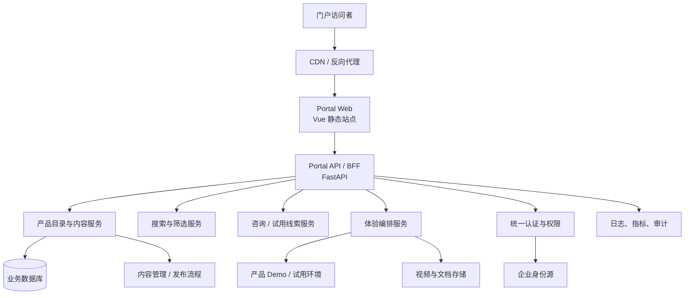

# Unicom Data Portal 项目现状与后续规划

> 更新时间：2026-10-10  
> 依据：当前代码、目录结构和最近提交记录整理。本文描述的是仓库实际状态，不把页面中的产品规划内容当作已交付能力。

## 1. 项目定位

Unicom Data Portal 是面向内部销售、合作伙伴和外部客户的数据智能产品门户。门户负责统一展示产品、产品能力、典型场景和体验入口；具体数据产品的业务能力应由各自产品环境提供。

当前仓库的定位是 **MVP 门户展示层**，不是数据产品运行平台，也不是统一的 IAM、租户或 CRM 系统。

## 2. 当前进展

### 已完成

- Vue 3 + TypeScript + Vite 前端工程已搭建，使用 Vue Router、Element Plus 和 Axios。
- 已实现统一布局：顶部导航、页脚、响应式页面容器和基础视觉变量。
- 已实现门户首页，包含产品体系、六阶段能力地图、产品架构示意、业务场景、核心产品和 CTA 入口。
- 已实现产品中心：产品家族筛选、产品列表、产品排序和产品详情跳转。
- 已实现产品详情通用模板：价值主张、核心能力、产品架构、业务场景、优势、案例/体验入口等区块。
- 已实现体验中心：演示、视频讲解、独立试用三类资源筛选，以及资源状态展示。
- 已实现解决方案、关于我们和 404 页面骨架。
- 产品和体验内容已抽离到 `frontend/src/data`，并有产品、体验的 TypeScript 类型定义。
- FastAPI 后端已搭建，提供 `/` 和 `/api/health`，具备 CORS、配置管理和 API 路由聚合结构。

### 当前可见的内容规模

- 产品数据包含 8 个产品，覆盖 5 个产品家族：数据基础设施、数据生产治理、智能语义、数据分析智能、数据流通。
- 体验资源以产品演示为主，当前大多数产品状态为 `preparing`；已有一个视频资源为 `available`。
- 业务内容目前主要是前端静态 TypeScript 数据，后端尚未提供产品目录、详情、案例或体验资源接口。

### 尚未完成或仅为占位

- `backend/app` 目前只有健康检查，没有业务 API、数据库模型、服务层实现或后台管理接口。
- `deploy`、`docs`、`content` 当前没有形成可执行的部署方案、内容发布流程或 API 契约；本文件是第一份项目现状文档。
- 解决方案页和关于页仍有明显占位内容；联系我们、客户案例等入口尚未接入真实流程。
- 体验中心没有连接真实 Demo、视频托管或隔离试用环境。
- 尚未发现认证、权限、租户、审计、监控、日志、自动化测试和 CI/CD 配置。
- 移动端菜单按钮目前只有视觉入口，没有展开交互。

## 3. 方案架构图

### 3.1 当前已实现架构

```mermaid
flowchart LR
    U[用户\n销售 / 合作伙伴 / 客户] --> B[浏览器]
    B --> V[Vue 3 门户\nVite + TypeScript]
    V --> R[Vue Router\n首页 / 产品 / 体验 / 解决方案 / 关于]
    V --> D[静态内容模型\nproducts.ts / experiences.ts / productFamilies.ts]
    V --> A[Axios API Client]
    A --> F[FastAPI\n/api]
    F --> H[/api/health]
    V --> E[外部产品体验入口\n当前为占位或规划链接]
```

当前请求链路很轻：页面展示主要依赖前端静态数据，后端仅用于健康检查和后续 API 扩展的骨架。`VITE_API_BASE_URL` 可用于配置前端 API 地址；后端默认 API 前缀为 `/api`。

### 3.2 目标业务架构



目标架构的核心边界是：门户管理“发现、理解、申请和跳转”，具体产品负责“真实业务能力和运行环境”。BFF 负责统一接口、聚合内容和对外隐藏各产品系统差异。

## 4. 目录与模块职责

| 目录 | 当前职责 |
| --- | --- |
| `frontend/src/views` | 首页、产品中心、产品详情、体验中心等页面 |
| `frontend/src/components` | Header、Footer、Hero 以及产品详情可复用组件 |
| `frontend/src/data` | 当前静态产品、产品家族和体验资源 |
| `frontend/src/types` | 产品和体验资源的 TypeScript 类型 |
| `frontend/src/api` | Axios 实例和健康检查 API |
| `backend/app/api` | FastAPI 路由和健康检查 |
| `backend/app/core` | 后端配置 |
| `backend/app/services`、`schemas` | 已预留，尚未实现业务逻辑 |
| `deploy`、`docs`、`content` | 已预留，尚未形成完整交付物 |

## 5. 主要问题与风险

1. **内容与业务解耦不足**：产品内容写在前端源码中，非研发人员无法独立维护，发布需要重新构建前端。
2. **体验状态不可验证**：页面可以展示“可用/准备中”，但没有健康探测、登录态检查或 Demo 环境编排。
3. **入口闭环未完成**：联系我们、案例、试用申请没有线索落库和通知机制，无法衡量转化。
4. **后端生产能力不足**：缺少数据库、鉴权、输入校验、错误码、分页、缓存和审计设计。
5. **发布与质量保障不足**：尚无部署清单、环境变量说明、测试、构建检查和回滚流程。
6. **编码与内容质量需统一**：部分历史文件在不同终端显示为乱码，发布前应统一 UTF-8 编码并校验中文文案。

## 6. 后续工作建议

### 阶段一：完成可发布的门户 MVP

- 补齐解决方案、关于我们、联系我们和客户案例内容。
- 为产品和体验资源定义稳定的数据字段、状态枚举和 slug 规则。
- 将真实 Demo、视频、文档链接接入体验中心；对不可用资源给出明确状态和替代 CTA。
- 完成移动端菜单交互、键盘访问、空状态、错误状态和基础 SEO 元信息。
- 建立本地开发、构建产物、环境变量和部署说明。

### 阶段二：接入内容与线索后端

- 在 FastAPI 中增加产品目录、产品详情、产品家族、案例、体验资源 API。
- 引入数据库和迁移机制，前端从 API 读取内容；保留构建时兜底数据以提高可用性。
- 增加咨询/试用申请接口、线索状态和通知渠道，并记录来源页面和产品。
- 增加管理端或接入现有 CMS，支持草稿、审核、发布、下线和版本追踪。
- 增加 OpenAPI 契约、统一错误响应、分页/筛选参数和接口权限。

### 阶段三：企业级能力

- 接入企业身份源和 RBAC，按角色、租户、产品和环境控制访问。
- 建设体验编排：申请、审批、环境创建、有效期、回收和使用审计。
- 增加搜索、埋点、漏斗分析、访问日志、链路追踪、指标告警和审计留痕。
- 建立 CI/CD、自动化测试、依赖与安全扫描、灰度发布和回滚策略。
- 按实际业务需要接入数据产品的 NL2SQL、RAG、Agent 等能力；这些属于产品能力，不应直接堆入门户展示层。

## 7. 建议的近期验收标准

- 访问首页、产品列表、任一产品详情、体验中心和 404 页面均正常。
- 产品筛选、详情跳转、体验资源筛选和返回路径可用。
- `GET /api/health` 返回 `status=ok`，前端 API 地址可通过环境变量配置。
- 生产环境能完成静态资源部署、HTTPS、日志采集和版本回滚。
- 所有“可用”体验入口经过真实可访问性检查；所有“准备中”入口有明确的后续动作。
- 产品内容、联系人和案例不再依赖直接修改 Vue 组件才能更新。

## 8. 结论

项目已经完成了一个可演示的产品门户前端骨架，产品信息架构和视觉展示方向基本成形；当前最大缺口在后端业务化、内容运营化、体验环境接入和生产交付能力。下一步应先收敛 MVP 发布范围并打通“产品详情 → 体验/试用 → 线索”的最小闭环，再建设 CMS、认证和企业级运营能力。

